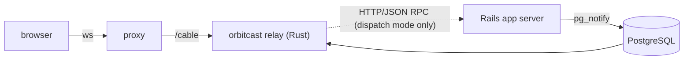

# OrbitCast

Real-time WebSocket relay for Rails. A Rust server holds the sockets and
speaks the standard ActionCable `actioncable-v1-json` protocol; a Ruby gem
integrates it into a Rails 8.1+ application. `@rails/actioncable`,
`turbo-rails`, and importmap pins work unchanged — the browser never learns
the transport changed.

Broadcasts travel over PostgreSQL `LISTEN/NOTIFY`. There is no Redis, no
extra service, and no build step.



Signed mode: the only link is Rails → PostgreSQL → relay. Dispatch mode adds
the relay → Rails RPC call.

## Installation

```bash
bundle add orbitcast
bin/rails generate orbitcast:install
```

The gem ships as platform gems (`arm64-darwin`, `x86_64-darwin`,
`x86_64-linux-gnu`, `aarch64-linux-gnu`, `x86_64-linux-musl`) with the Rust
executable vendored — no compiler, no download step. Floors: macOS 13,
glibc 2.34 for the GNU gems (older distributions use the musl gem).

Building from source instead:

```bash
cargo install orbitcast                                     # PostgreSQL backend (default)
cargo install orbitcast --no-default-features --features memory   # single-process dev
```

Exactly one pub/sub backend is compiled in.

## Quickstart (signed mode)

The generator writes `config/cable.yml` (`adapter: orbitcast`, a derived
namespace, the cable DSN) and `config/initializers/orbitcast.rb`
(`mode: :signed`, the stream key, the Turbo key export), and appends
`cable: bundle exec orbitcast serve` to `Procfile.dev`. Point
`config.action_cable.url` at the relay, set
`config.action_cable.mount_path = nil`, and:

```bash
ORBITCAST_LISTEN_ADDR=127.0.0.1:28080 bin/dev
```

`turbo_stream_from`, `broadcast_*_to`, and
`ActionCable.server.broadcast` work as before. Subscriptions are authorized
by signed stream names (Turbo's own, CableReady's, or
`Orbitcast.signed_stream_name` claims tokens); no application Ruby runs on
the socket path.

## Two modes

| | `mode: :signed` (default) | `mode: :dispatch` |
| --- | --- | --- |
| What authorizes a subscription | a signed stream name, verified locally | Rails, per connection and per channel |
| Application Ruby on the socket path | none | `connect`, `subscribed`/`unsubscribed`, `perform` actions — real ActionCable code via `Orbitcast::Connection` / `Orbitcast::Channel` bases |
| Extra moving part | none | a private HTTP/JSON RPC endpoint mounted by the engine (`/_orbitcast/v1/rails`), called by the relay |
| Rails outage | broadcasts queue up in Rails; sockets unaffected | connections close with `reconnect: true`; never a fallback to signed acceptance |

Dispatch mode is opt-in (`config.orbitcast.mode = :dispatch` plus
`rpc_token`/`rpc_endpoint_url`).

## Capability matrix

| Capability | signed | dispatch |
| --- | --- | --- |
| Broadcasts / Turbo Streams / CableReady | yes | yes |
| Channel actions (`perform`) | no — dropped, observable | yes |
| Connection / channel callbacks | no | yes |
| Presence | no (the legacy `join`/`leave`/`presence` commands are dropped, observable) | yes — PostgreSQL-backed, granted per subscription by Rails (`grant_presence`); in-process in `memory` builds |
| Remote disconnect (`Orbitcast.disconnect`) | no (no identity index) | yes |
| Recovery (retained replay) | opt-in, works if the broker is enabled — the token is its own authorization | same |

## Transports

Two independent transports; either or both:

- **Direct HTTP/WebSocket** — `ORBITCAST_LISTEN_ADDR=IP:port`. Serves
  `GET /cable`, `GET /healthz`, `GET /readyz`. Origin validation, connection
  and frame limits, and subprotocol negotiation are built in.
- **Docking** — OrbitCast runs as a
  [Mothership](https://github.com/seuros/mothership) ship over a Unix
  socket; the [`guardship`](https://rubygems.org/gems/guardship) gem wraps
  the supervisor environment this needs.

A third, private listener — the HTTP ingress (`ORBITCAST_INGRESS_LISTEN_ADDR`,
loopback by default) — accepts `POST /v1/publications` (for
`publish_via: :http`, e.g. memory builds or database-credential isolation)
and `POST /v1/control` (Rails-initiated disconnects). Bearer-authenticated,
never mounted on `/cable`.

## Pub/sub

PostgreSQL is the backbone: Rails publishes with `pg_notify`, every relay
node listens, channels are derived from the `(namespace, stream)` pair.
Namespaces isolate deployments sharing one database. The `memory` backend is
for single-process development only.

**Overflow relay.** PostgreSQL rejects `NOTIFY` payloads of 8000 bytes or
more. Opt-in on both sides (`overflow_enabled` plus the
`orbitcast_payloads` migration), oversized publications are written to a
short-lived relay table and referenced in the same transaction; without it,
an oversized broadcast raises `Orbitcast::PayloadTooLarge` rather than being
truncated or dropped.

## Broker and recovery (both opt-in)

**Broker.** Off by default. With `broker_enabled` (plus its migrations),
publications to configured stream prefixes that
**reach the relay** are additionally *retained* in PostgreSQL with a
per-stream commit order, an identity, and bounded retention (time, count,
bytes per stream; messages and bytes per namespace). Ordinary delivery is
untouched; retention is what recovery replays.

Honestly: only publications that pass through the relay are retained. That
is the private HTTP ingress (`publish_via: :http` on the Rails side, or any
publisher posting to `/v1/publications`). The default `publish_via:
:postgres` has Rails emit `pg_notify` itself and never touches the broker,
so **nothing published that way is retained or recoverable**. A deployment
that wants recovery for Rails broadcasts sets `publish_via: :http`.

**Recovery.** Off by default. A Rails-minted, separately-keyed recovery
token (`Orbitcast.recovery_token`) lets a client subscribe to the reserved
`Orbitcast::RecoveryChannel` and replay retained history from opaque
cursors, with an importmap-ready helper
(`gem/app/assets/javascripts/orbitcast/recovery.js`). An unchanged
ActionCable or Turbo client never sees any of this. The token is necessary,
not sufficient: every resume re-checks that the connection is identified,
the token still valid, and the connection subscribed to each stream it
replays (subscribe to your streams first, then create the recovery
subscription). Fencing is per session: a newer resume of the same
`session_id` wins. A resume without cursors continues from the session's
last acknowledged position when the relay still has it. Delivery is
at-least-once within retention, deduplicated by publication id; expired,
trimmed, or wiped history is reported as an explicit gap, not silently
skipped.

## Configuration

Precedence: CLI flags > `ORBITCAST_*` environment > TOML file
(`ORBITCAST_CONFIG`) / Rails-exported configuration > defaults. Validation
is fail-closed: unknown keys, malformed values, invalid base64, and a
profile enabled without its own key are startup errors. Service credentials
(`ORBITCAST_RPC_TOKEN_BASE64`, `ORBITCAST_INGRESS_TOKEN_BASE64`) are
environment-only.

## Health, readiness, observability

`GET /healthz` is process liveness (always `200`); `GET /readyz` is `200`
only while the pub/sub backend is ready, the node is not draining, and, in
dispatch mode, Rails answers `describe` with a supported envelope version.
Its JSON body names the failing component. A PostgreSQL build that cannot
reach its database at startup exits instead of idling unready.
Structured JSON logs on stdout; drops, gaps, reconnects, and rejections are
counted and warned. `GET /metrics` (Prometheus text) is served on the
private ingress listener behind its bearer credential.

## Deployment sketch

```text
internet ──TLS──▶ proxy ──▶ /cable        ──▶ relay ORBITCAST_LISTEN_ADDR (private)
                       └──▶ everything else ──▶ Rails
private network only:  relay ◀── POST /v1/publications, /v1/control (ingress)
                       relay ──▶ POST /_orbitcast/v1/rails/* (dispatch RPC; block at proxy)
```

The relay serves no TLS itself: terminate public TLS at the proxy, bind the
relay to loopback or a private interface, and keep `/healthz`, `/readyz`,
the ingress, and the Rails RPC mount off the public internet.

## Supported versions

| | floor |
| --- | --- |
| Rust (building from source) | 1.99 (MSRV; `rust-toolchain.toml` pins the same channel) |
| Ruby | >= 4.0 |
| Rails (`railties`/`actioncable`) | >= 8.1 |
| PostgreSQL | any maintained release; plain `LISTEN/NOTIFY`, advisory locks, and `timestamptz` — no extensions. The 8000-byte `NOTIFY` payload limit applies to every version. The relay's listener needs a real session: direct connection or session pooling, never PgBouncer transaction mode. |

## License

BSD-3-Clause
